# GOAD Purple Team Lab

**Project log, results and screenshots — 12 to 16 October 2026.**

Last updated: **16 October 2026**.

Personal penetration-testing project on a deliberately vulnerable Active Directory
environment, based on [GOAD](https://github.com/Orange-Cyberdefense/GOAD).
Wazuh makes it possible to observe the traces and to check the detection of the tests.
This project also serves as a PPE deliverable for the course *Project management techniques*
(CFC 306, Project 5).

## Contents

- [Progress](#progress)
- [Environment and schedule](#environment-and-schedule)
- [Log and screenshots](#log-and-screenshots)
  - [Monday 12 October — preparation](#monday-12-october--preparation)
  - [Tuesday 13 October — installation and validation](#tuesday-13-october--installation-and-validation)
  - [Wednesday 14 October — first tests](#wednesday-14-october--first-tests)
  - [Thursday 15 October — lateral movement and DCSync](#thursday-15-october--lateral-movement-and-dcsync)
  - [Friday 16 October — report, review and publication](#friday-16-october--report-review-and-publication)
- [Difficulties and decisions](#difficulties-and-decisions)
- [Next steps](#next-steps)
- [Useful documents and sources](#useful-documents-and-sources)

## Progress

| Step | Status as of 16 October |
| --- | --- |
| Install the lab and its isolated network | Done and verified |
| Install Wazuh and receive events from both machines | Done and verified |
| Carry out the penetration test | Lateral movement and domain compromise achieved |
| Verify the detection of each technique | Lateral movement and DCSync correlated in Wazuh; detection gap documented on 4688 |
| Verify the complete rebuild of the lab | Actually tested: 47m59s (15 min target not met), 2 failures fixed live |
| Write the report, the detection guide and the review | Done — [report](./rapport-pentest.md), [playbook](./playbook-detection.md), review in the [project specification](./cahier-des-charges.md#bilan-de-clôture-et-retour-dexpérience-rex) |
| Publish the deliverables on the portfolio | To do |

**The `bob` account, compromised on Wednesday through a readable LDAP description, allowed
code execution as LocalSystem on WS01 (lateral movement).** On Thursday, a DCSync
with the `alice` account (Domain Admins, scenario credentials) extracted the hash
and Kerberos keys of the `Administrator` account: **domain compromise achieved**.
On Friday, the BloodHound mapping of the domain and the real test of a complete rebuild
were both carried through — with honest results rather than rounded ones:
a tooling/field-reality gap for BloodHound (finding F5), and
a rebuild that **does not meet** the 15-minute target (47m59s actual).

## Environment and schedule

| Item | Chosen configuration |
| --- | --- |
| Host | Personal machine running Pop!_OS, 16 GB of RAM |
| Virtualization | KVM/QEMU and libvirt; local adaptation of GOAD MINILAB |
| DC01 | Windows Server 2019, Windows name `DC`, domain `mini.lab`, `192.168.56.30` |
| WS01 | Windows Server 2019, Windows name `WS`, domain member, `192.168.56.31` |
| Windows resources | 2 vCPU and 2 GiB of RAM per VM |
| Testing tools | On the host to save memory |
| Monitoring | Wazuh 4.14.0 manager in a container, limited to 1 GiB / 1 CPU, two Windows agents |
| Wazuh interface | No indexer or dashboard; events and agents checked with local tools |
| Networks | `goad-purple-lab` and `goad-purple-mgmt`, isolated after installation |

Planned budget: **20 hours in total, about 4 hours per day**.
The human time actually spent on the project remains to be recorded; waiting
for downloads and installations is not counted as measured work.

| Day | Plan and status |
| --- | --- |
| Monday 12 | Lab preparation started |
| Tuesday 13 | Installation completed and validated; preparation overran by one day |
| Wednesday 14 | Reconnaissance, first finding and direct screenshots |
| Thursday 15 | Lateral movement (SYSTEM on WS01) and DCSync successful, detections correlated |
| Friday 16 | Finalising the report, review and publication, to be done |

## Log and screenshots

All published images appear below, in the log of the relevant day.
The files are stored in [`screenshots/`](./screenshots/), by date.

**Screenshot dates:** the four direct screenshots of the Windows windows were
taken on **14 October between 09:27 and 09:31 in Zurich** (07:27–07:31 UTC).
For **12 and 13 October**, no original screenshot of the windows was kept.
The written follow-up of those days is presented below.

### Monday 12 October — preparation

- Preparation of the dependencies and Windows images, pinned and verified versions.
- Normalisation of the first Windows image to allow WinRM provisioning.
- Configuration of the controller and of the `mini.lab` domain from the GOAD scenario.
- Installation of the Wazuh manager and of the agent on DC01.
- Receipt of real events: successful network logon (4624 / rule 100101)
  and deliberate failure with a non-existent account (4625 / rule 100100).

**Result:** collection on DC01 works. These preparation tests do not
prove any compromise; DCSync detection remains to be tested.

### Tuesday 13 October — installation and validation

- Adaptation of the GOAD network discovery: interfaces are computed per host.
- Replacement of the expired Windows 10 image with a Windows Server 2019 member server.
- Generalisation of WS01 with Sysprep to give it a distinct Windows identity,
  then restoration of the private network and removal of the temporary task used.
- Joining WS01 to the domain and installing its Wazuh agent.
- Isolation of the two networks and publication of the scripts and fixes on GitHub.
- Startup fix: DC01 is started before WS01 to ease domain discovery.

**Checks of 13 October around 09:41 in Zurich (07:41 UTC):**

| Check | Observed result |
| --- | --- |
| DC01 | `DC`, domain `mini.lab`; DNS, Kerberos, LDAP, SMB and WinRM reachable |
| WS01 | `WS`, domain `mini.lab`; SMB and WinRM reachable |
| WS01 → DC01 trust relationship | `Test-ComputerSecureChannel : True`; `nltest : NERR_Success` |
| Agents | `dc` (001) and `ws` (002) active; Wazuh service started on both hosts |
| DC01 collection | Event 4624 / rule 100101 received at 07:41:14.582 UTC |
| WS01 collection | Event 4624 / rule 100101 received at 07:41:15.531 UTC |
| Isolation | No `forward` element, DNS relay disabled on both networks |
| Windows | Server 2019 on both VMs; evaluations active during the check |

The logons above come from the validation administration.
4662 events / rule 100102 appear during provisioning:
**they do not prove a DCSync attack**.

### Wednesday 14 October — first tests

**Objective:** identify the lab's services and carry out a first test with a
matching Wazuh trace. The tests only concern DC01 and WS01.

1. Restart of the networks, the Wazuh manager, DC01 and then WS01.
2. Check of the domain, the trust relationship and the agents.
3. Scan of twelve TCP ports on each machine.
4. LDAP read with the `dave` account, provided by the GOAD scenario.
5. One SMB connection as `bob`, with the password discovered in its description.
6. Search and correlation of the logon event on the Wazuh side.

**This is a guided exercise: the initial account is known thanks to the scenario.**
Passwords and raw logs stay out of the public repository.

#### Results of the first tests

##### The lab's two roles are visible

| Machine | Role | Open services among the ports tested |
| --- | --- | --- |
| DC01 | Central domain server | DNS, Kerberos, LDAP directory, SMB share, Windows administration and remote desktop |
| WS01 | Domain member server | SMB share, Windows administration and remote desktop |

The scan is limited to ports 53, 88, 135, 139, 389, 445, 464, 636, 3268, 3269,
3389 and 5985. It is not an exhaustive inventory of all ports.
The BloodHound mapping has not been carried out yet.

##### A first weakness is confirmed

The `dave` account can read the description of the `bob` account. This description
contains `bob`'s password in clear text. An SMB connection as `bob` then
succeeded on DC01 with that value, with no guessing or dictionary attempts.
The password stays masked and is not published.

**Demonstrated consequence:** a domain user can take over another
account from information readable in the directory.

**Proposed fix:** remove passwords from descriptions, change
the exposed password and check the rights granted to the account concerned.
The lab remains deliberately vulnerable during the exercise; this fix
was not applied to the test machines.

The LDAP read also shows `bob` in `wsadmin`, as well as `alice` and `carol`
in `Domain Admins`. These memberships do not yet prove execution
on WS01 or a domain compromise.

##### Wazuh recorded the logon

| Field | Observed value |
| --- | --- |
| Time received by Wazuh | 14 October 2026, 08:45:11 in Zurich (06:45:11 UTC) |
| Machine | DC01, agent dc |
| Account | bob |
| Windows event | 4624, network logon, type 3 |
| Wazuh rule | 100101 |
| Source | Lab test host, 192.168.56.1 |

The test took place at 06:45:10–06:45:11 UTC; the alert was received at
06:45:11.965 UTC. The match covers the time, the account, the source and the machine.
The rule detects a network logon; it does not by itself demonstrate the theft
of the password or the reading of its LDAP description.


#### Direct screenshot 1 — WS registered in Active Directory

**DC01 · Active Directory Users and Computers · 14 October, 09:27 in Zurich.**
The `Computers` container of `mini.lab` contains the `WS` object. This view shows
its registration in the directory; it does not test the trust relationship.

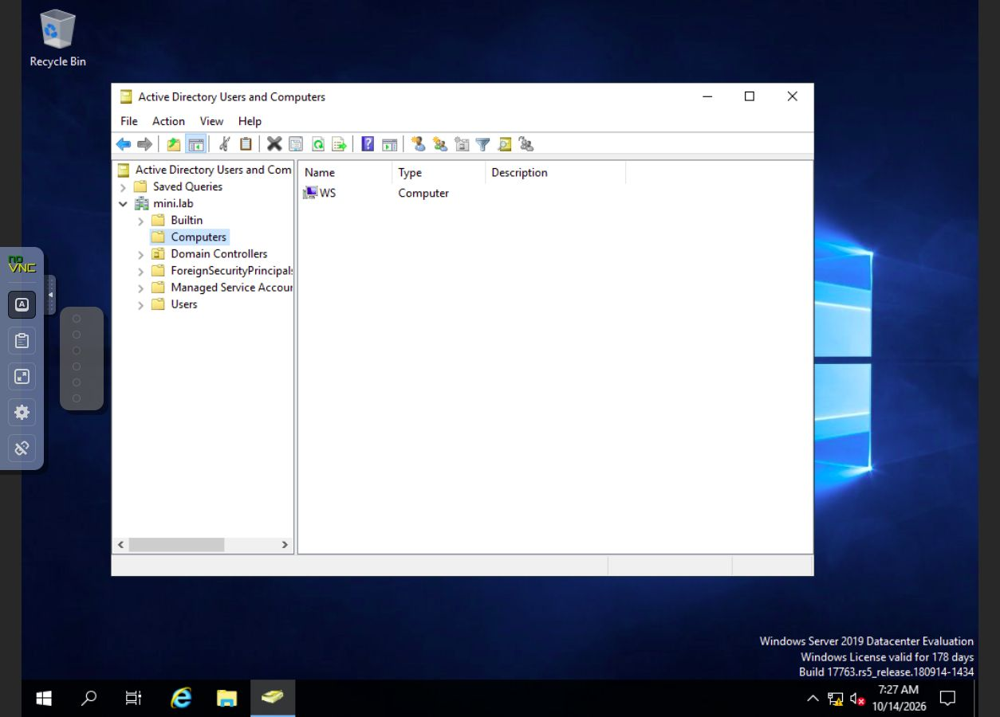

#### Direct screenshot 2 — domain controller

**DC01 · same console · 14 October, 09:30 in Zurich.**
The `Domain Controllers` container contains `DC`, with `GC` for global catalog.

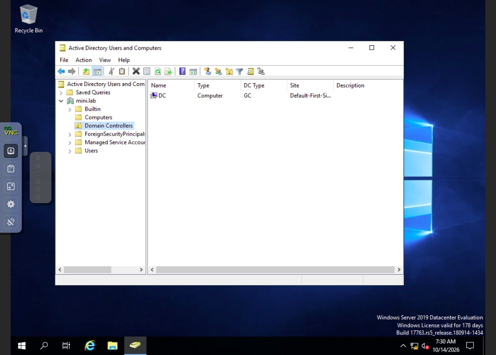

#### Direct screenshot 3 — domain and Wazuh service in PowerShell

**WS01 · Windows PowerShell · 14 October, 09:30 in Zurich.**
The `MINILAB\vagrant` session shows the name `WS`, the domain `mini.lab`,
`PartOfDomain : True` and the `WazuhSvc` service in the `Running` state.

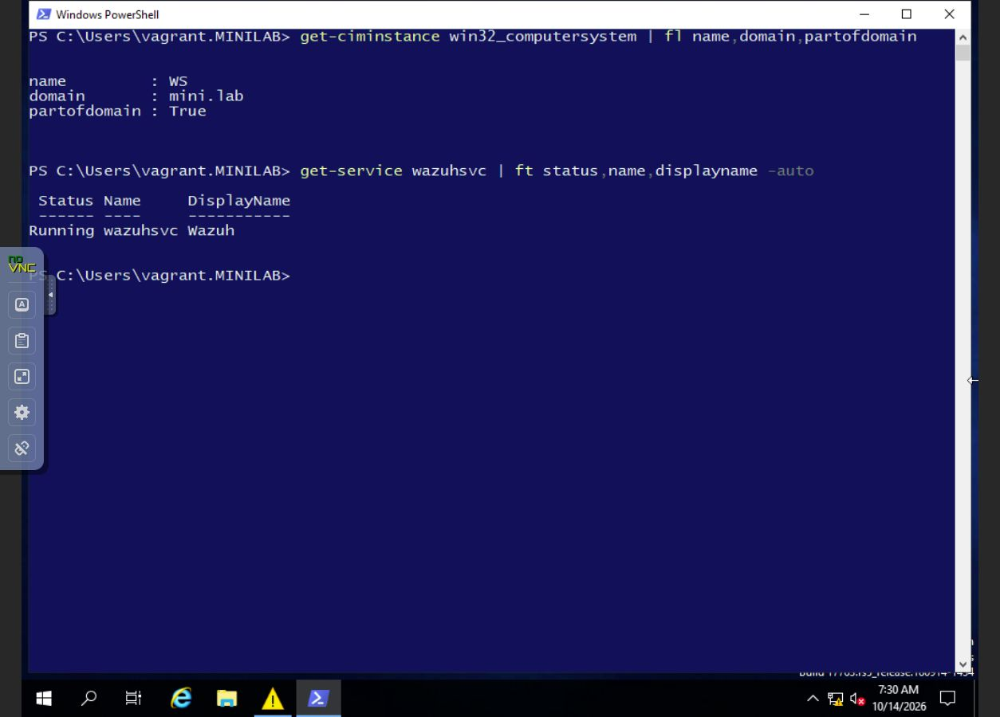

#### Direct screenshot 4 — Wazuh agent in the Windows services

**WS01 · Windows Services · 14 October, 09:31 in Zurich.**
The selected service shows `Wazuh`, the `Running` state and the `Automatic` startup.
These two screenshots of the service establish its local state; receipt on the
manager side is documented by the correlated events above.

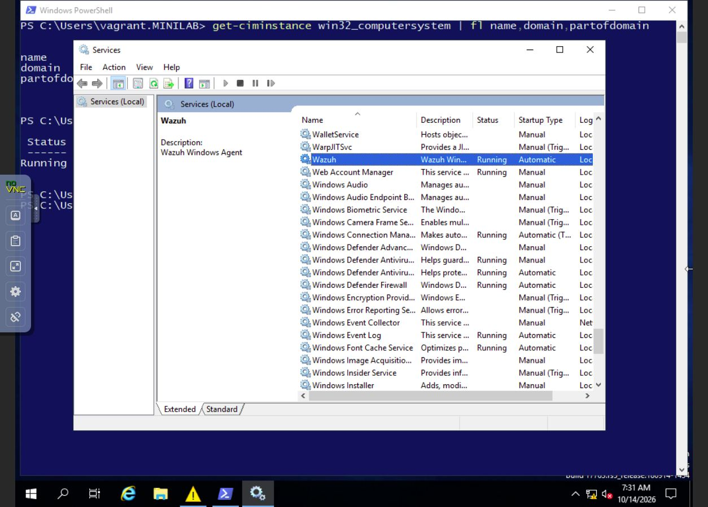

These four images are unretouched screenshots of the real consoles of the VMs,
viewed through noVNC. The Windows clock at the bottom of the images is in UTC.
They show the checks of the 14th, without proving the attacks on their own.

#### Clock correction and traceability

A shift of about **seven hours ahead** of the Windows clocks was
identified. The test times on the host and the Wazuh receipt times are distinguished
from the internal Windows times. The initial test used NTLM; no Kerberos
success is claimed.

Both VMs were reset to UTC time. A new reading around 06:59 UTC
measured about 1.55 s of drift for DC01 and 0.52 s for WS01. The domain and
the Wazuh services were also checked. The initial traces are kept
with their original times.

### Thursday 15 October — lateral movement and DCSync

**Objective:** check whether `bob`'s credentials (found on Wednesday) allow
real code execution on WS01, then attempt the domain compromise through DCSync
with a Domain Admins account from the scenario, correlating each step on the Wazuh side.

#### Lateral movement

1. Rediscovery of `bob`'s password through LDAP read (same technique as Wednesday).
2. `wmiexec.py` fails on the client side: the DCOM connection stays blocked after the selection
   of the dynamic RPC port (49667), even though that port is open. Cause not confirmed.
3. `smbexec.py` then `psexec.py` (two attempts): the `ADMIN$` share is writable
   with `bob`'s credentials, a binary is dropped, a Windows service
   is created then started. **The three services run as `LocalSystem`** — demonstrating
   code execution with the highest privileges on WS01, even though the output of
   the command (`whoami`) could not be retrieved on the client side (blocking on the output
   channel, with no impact on the result of the attack).
4. Check afterwards: the three services deleted themselves automatically
   (normal behaviour of the Impacket tools); no residual artefact on WS01.

**Side observation:** repeated network logons by the `carol` account (Domain
Admins) from DC01 to WS01 were spotted during the test, every ~30
seconds. Check made (`query session`): no interactive session, network-type
logon only — unexplained at the time, attributed to background activity
of the GOAD lab. **Update of 16 October:** the exact cause was
identified during the full replay of the provisioning — a scheduled task
(`vulns/schedule`, `connect_bot`) runs `bot.ps1` every minute on DC01
using a credential of `alice` stored in the Credential Manager
(CredSSP); it is not `carol` herself but an intentional simulation of the
MINILAB scenario, unrelated to our tests — confirmed, not just assumed.

#### Domain compromise (DCSync)

With `alice`'s credentials (Domain Admins, provided by the GOAD scenario — guided test,
as with `dave` on Wednesday):

```
secretsdump.py -just-dc-user administrator mini.lab/alice:***@192.168.56.30
```

**Result:** successful extraction of the NTLM hash and Kerberos keys (AES256, AES128,
DES) of the `Administrator` account. Replication deliberately limited to a single account
(`-just-dc-user administrator`), in line with the project specification. Secrets not
published, kept only locally.

#### Detection on the Wazuh side

| Technique | Rule triggered | Result |
| --- | --- | --- |
| Network logons by `bob` (4 attempts) | 100101 (custom, level 6) | 28 correlated 4624 events, agent `ws`, source 192.168.56.1 |
| Service drop via an admin share (`smbexec`/`psexec`) | **92650** (**native** Wazuh rule, level **12**) | 2 alerts: *"New Windows Service Created to start from windows root path. Suspicious event as the binary may have been dropped using Windows Admin Shares."* — a more severe detection than any custom rule of the project |
| Process creation (4688) during the tests | 67027 (generic default rule, level 3) | 729 occurrences, but with no correlation to the account or the context — **detection gap documented**: collected and technically alerted, but drowned in noise, unusable for triage |
| DCSync (AD replication rights) | 100102 (custom, level 10) | 3 4662 events, account `alice`, GUID `1131f6aa`/`1131f6ad` (DS-Replication-Get-Changes / -All), timestamp matching the test to the second |

**Key point for the final report:** the most severe detection of the day (level 12)
comes from a **default** Wazuh rule, not from a rule written for this project — a good
argument for the "value of the base ruleset" part of the detection guide.

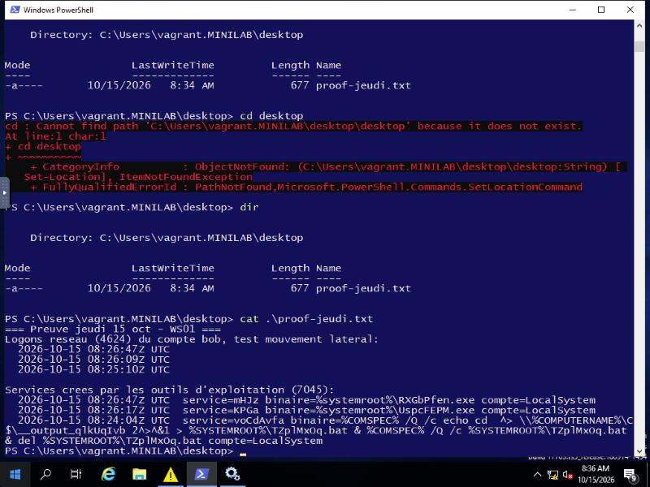

**WS01 · PowerShell console · 15 October, 08:36 UTC.** Capture of the content of an
evidence file generated from the Windows logs, showing the timestamps
of `bob`'s logons and of the three LocalSystem service creations.

### Friday 16 October — report, review and publication

Restart of the lab (VMs and Wazuh manager stopped overnight, restarted and
revalidated): domain joined, Wazuh agents `Running` on both machines.

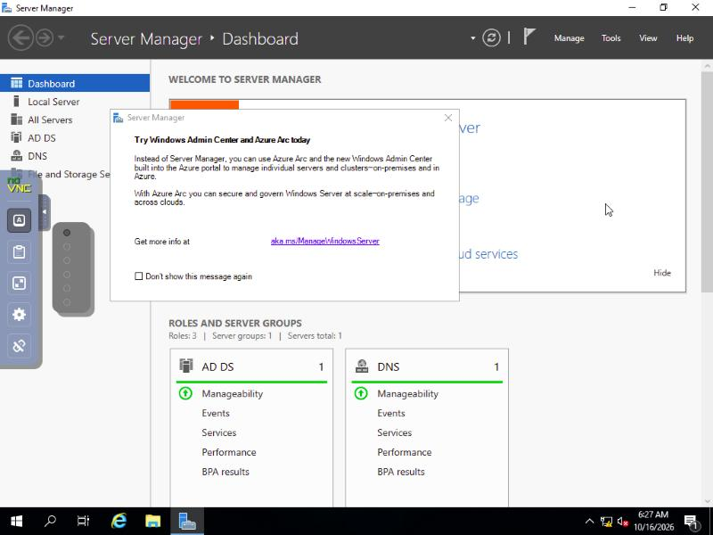

**DC01 · Server Manager · 16 October, 06:27 UTC.** Dashboard confirming
the 3 installed roles (AD DS, DNS, File and Storage Services) — proof of
the installation of the domain controller, complementary to the WinRM checks
already published.

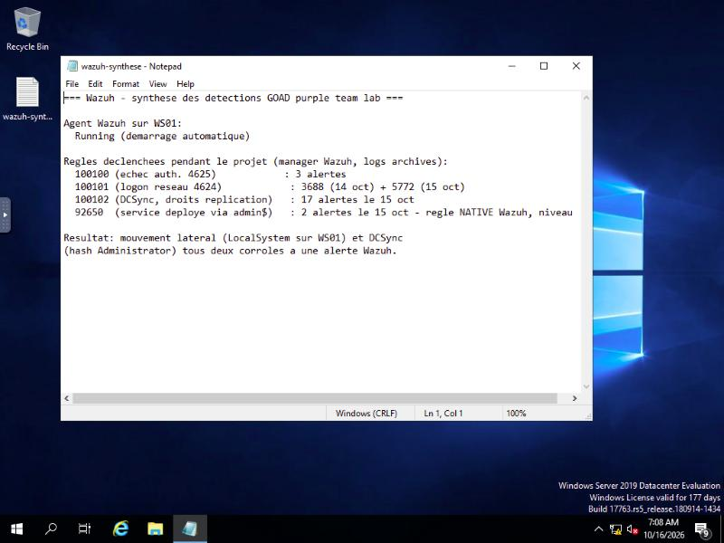

**WS01 · Notepad · 16 October, 07:08 UTC.** Summary of the Wazuh alerts
triggered across the whole project: agent state, and count per
rule (100100, 100101, 100102, 92650) over the days of the 14th and 15th.

#### Live replay of the two techniques, with raw evidence

To document each step in a verifiable way, the lateral movement and the
DCSync were replayed live in a terminal, then each trace was
retrieved as a **raw** export (`Get-WinEvent`, not reworded) rather than
summarised.

**Terminal (Linux, lab host):**

```
$ export BOB_PW=$(.venv/bin/python get-bob-pw.py)   # password rediscovered through LDAP, never displayed
$ date -u && timeout 30 .venv/bin/psexec.py "mini.lab/bob:${BOB_PW}@192.168.56.31" whoami && date -u
Fri 16 Oct 14:01:11 UTC 2026
Impacket v0.13.1
[*] Found writable share ADMIN$
[*] Uploading file boZsxcxx.exe
[*] Creating service vwoy on 192.168.56.31.....
[*] Starting service vwoy.....

$ export ALICE_PW=$(.venv/bin/python get-alice-pw.py)
$ date -u && .venv/bin/secretsdump.py -just-dc-user administrator "mini.lab/alice:${ALICE_PW}@192.168.56.30" && date -u
Fri 16 Oct 14:02:07 UTC 2026
Administrator:500:aad3b435b51404eeaad3b435b51404ee:c66d72021a2d4744409969a581a1705e:::
[*] Cleaning up...
Fri 16 Oct 14:02:07 UTC 2026
```

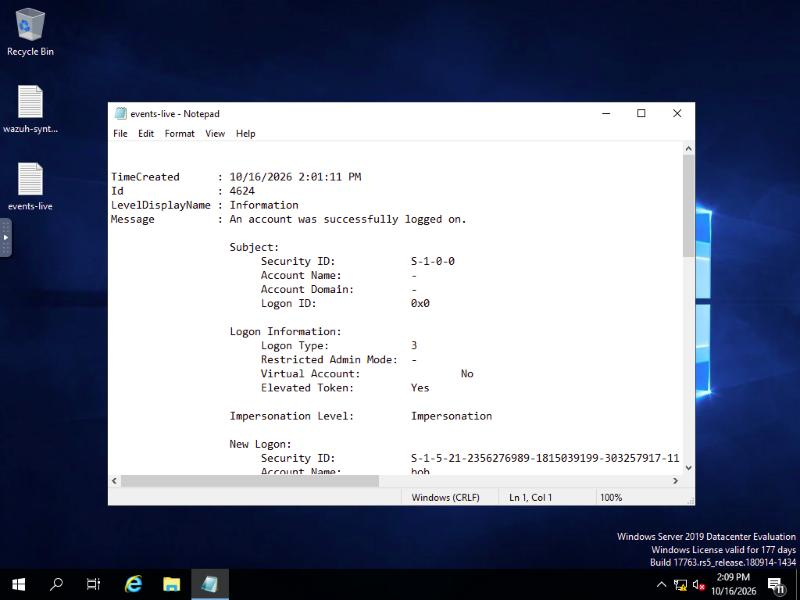

**WS01 · raw `Get-WinEvent` export · 14:01:11 UTC.** Same second as the
`psexec` command above: network logon (type 3) of the `bob` account.

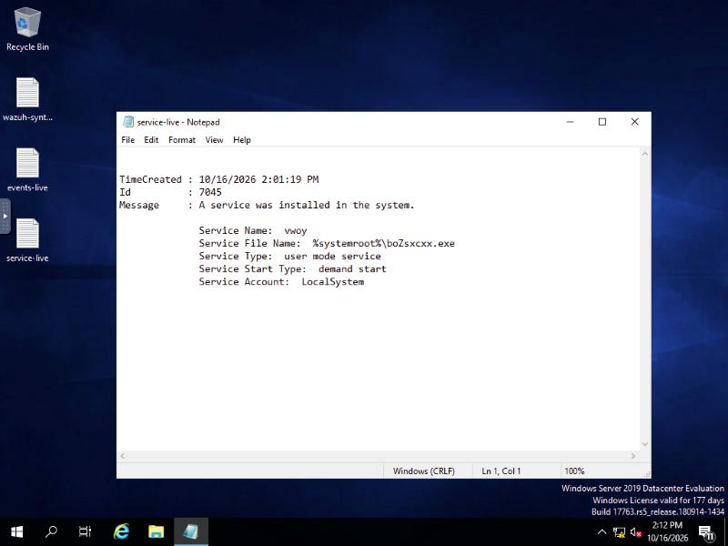

**WS01 · raw export · 14:01:19 UTC.** Service `vwoy`, file
`boZsxcxx.exe`, account `LocalSystem` — names strictly identical to the
terminal output: direct proof that the service was indeed created and
started with the highest privileges, independently of the retrieval
of the `whoami`.

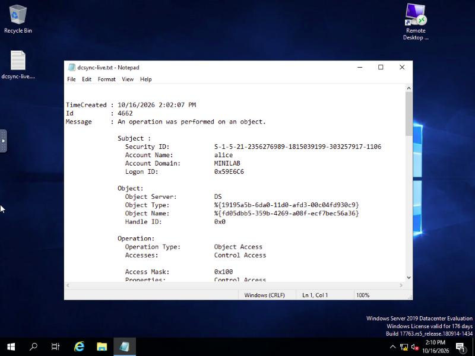

**DC01 · raw export · 14:02:07 UTC.** Same second as the `secretsdump`
command above: AD replication rights used by `alice`
(Object Server `DS`).

#### Installation evidence (roles and system configuration, raw data)

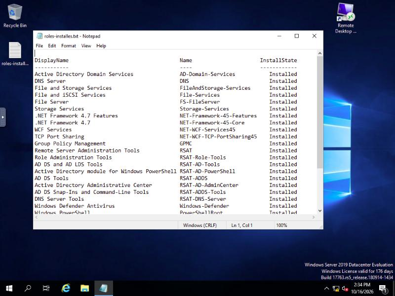

**DC01 · raw `Get-WindowsFeature` export.** Complete, unreworded list
of the roles and features actually installed: `AD-Domain-Services`,
`DNS`, `FS-FileServer`, `RSAT-AD-Tools`, `RSAT-ADDS`, etc.

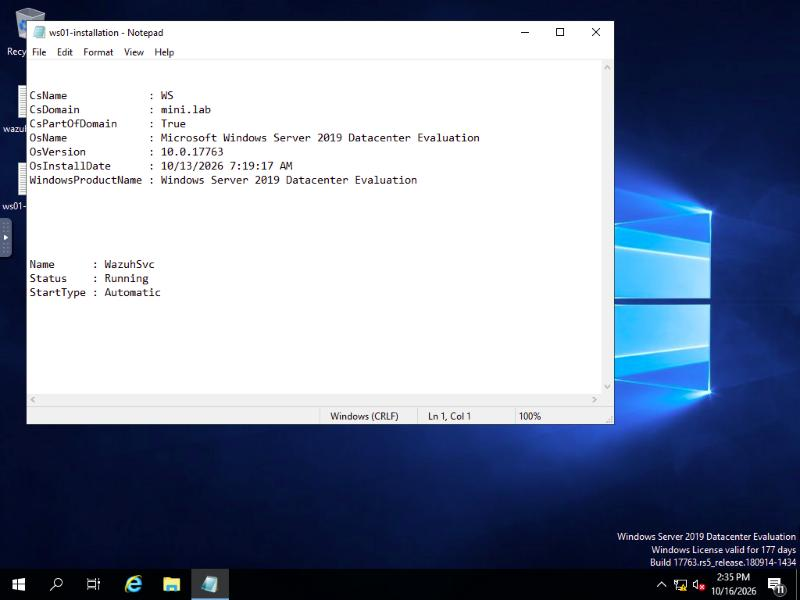

**WS01 · raw `Get-ComputerInfo` export.** Machine name, domain `mini.lab`,
`PartOfDomain : True`, OS installation date (13 October, day of the
actual deployment) and Wazuh service `Running`.

#### Domain mapping (BloodHound)

Real collection with `bloodhound-python` (`dave` account, standard, `-c All`):

```
$ ../../../.venv/bin/bloodhound-python -u dave -p "${DAVE_PW}" -d mini.lab -dc dc.mini.lab -ns 192.168.56.30 -c All --zip
INFO: Found AD domain: mini.lab
INFO: Found 2 computers
INFO: Found 9 users
INFO: Found 54 groups
INFO: Found 2 gpos
INFO: Querying computer: ws.mini.lab
INFO: Querying computer: dc.mini.lab
INFO: Done in 00M 00S
```

The group analysis confirms Wednesday's enumeration (`alice`/`carol`
in `Domain Admins` **and** `wsadmin`; `bob` only in `wsadmin`) —
but the `AdminTo` relationship for WS01 came back **empty**, whereas the
lateral movement of 15 October proved the opposite. Field verification:

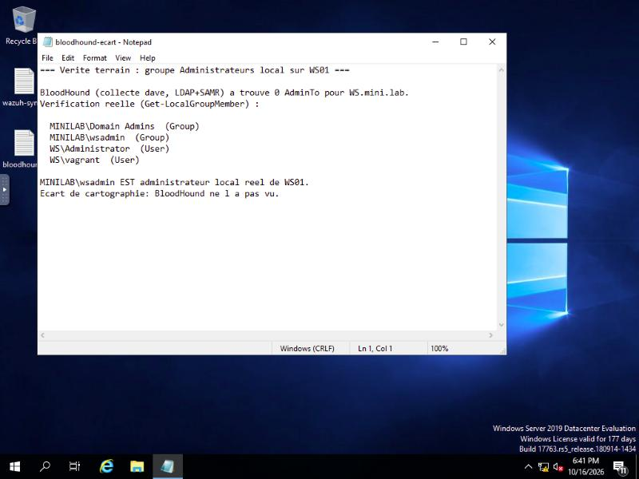

**WS01 · raw `Get-LocalGroupMember` export.** `MINILAB\wsadmin` is indeed a
real member of the local `Administrators` group — a relationship that BloodHound,
collected with a standard domain account, did not see. Detail and
technical explanation in the [pentest report, finding F5](./rapport-pentest.md#f5--écart-entre-cartographie-automatisée-bloodhound-et-réalité-terrain).

**Confirmation obtained later in the day**: the full replay of the
provisioning (see below) showed the exact Ansible task that creates
this relationship — `Add domain users to local groups` → `Administrators:
[MINILAB\wsadmin]` on WS01, configured by directly modifying the machine's
local SAM, not through a GPO. This is precisely the mechanism that
escapes a BloodHound collection based on LDAP/GPO.

#### Validation of the complete rebuild from scratch

**Project specification objective:** complete redeployment of the lab in less
than 15 minutes. This test had never actually been done until now — all
the previous validations concerned VMs that were already provisioned. Here is
the real result, without rounding in our favour.

**Full timeline (`vagrant destroy -f` → lab validated, UTC):**

| Time | Event |
| --- | --- |
| 18:43:37 | `vagrant destroy -f` on both VMs |
| 18:43:37–18:47:23 | `make up` (restart of the VMs from the box, Sysprep of WS01) |
| **18:47:23** | **Failure no. 1** — `generalize-member.py` raises an exception: WS01's network interface gets a link-local address (`169.254.x.x`) instead of `192.168.56.31` after the post-Sysprep reboot (non-deterministic re-enumeration of the network cards) |
| 18:48–18:52 | Diagnosis: IP fixed manually, `make provision` relaunched |
| **18:49:09** | **Failure no. 2** — the Ansible task `Upgrade module PowerShellGet` fails: Internet access is needed to download the `NuGet` provider, yet the `goad-purple-mgmt` network had stayed **isolated** (no NAT) since the session of 13 October — a state that persists independently of the destruction/recreation of the VMs |
| 18:52:39 | NAT temporarily re-enabled on `goad-purple-mgmt` (from its original definition), **with explicit authorisation** before any network change |
| 18:52–18:58 | VMs restarted at the hypervisor level to reattach to the recreated network bridge; time zone fixed to UTC (same symptom as on 14 October — clock 7h off, root cause never durably fixed) |
| 18:58:50 | `make provision` relaunched |
| 19:27:20–19:29:30 | Installation of the Wazuh agents (`wazuh/install-agents.yml`), after a **3rd error** of forgotten Ansible environment variables (fixed immediately, with no impact on the lab) |
| 19:30:00 | Re-isolation of the two networks (`scripts/isolate.sh`) — confirmed with no outside forwarding or DNS relay |
| **19:31:36** | **Final validation:** domain joined on both machines, Wazuh `Running` on both, 5067 alerts already collected |

**Total duration: 47 minutes 59 seconds. Project specification target (< 15
minutes): not met.**

**What this really means:** even counting only the successful
run (without the two failures), the complete provisioning — AD domain,
DNS, scenario accounts, rights, Wazuh — takes about **30 minutes**.
The existing automation (`make up` + `make provision` +
`install-agents.yml`) works well technically (0 Ansible failures over
the whole successful run, apart from the 2 upstream infrastructure problems),
but it **assumes an environment already in its initial state**: it does not
handle reopening the management network after a previous isolation,
and it is sensitive to the re-enumeration of network interfaces
after Sysprep. These are two real limits of the automation, not
one-off failures of the lab.

Session devoted to finalisation: pentest report, detection guide,
progress reports, review and lessons learned, then publication.

## Difficulties and decisions

| Difficulty | Decision and result |
| --- | --- |
| GOAD to adapt for KVM/libvirt | Local adaptation of MINILAB to two machines to respect the available resources |
| Expired Windows 10 image, automatic shutdowns | WS01 recreated on Windows Server 2019 |
| Wrong network interface discovery | Interfaces computed per host instead of a result shared with `run_once` |
| Identical Windows identity between clones | Generalisation of WS01 with Sysprep, then domain join |
| Domain discovery badly initialised at startup | Discovery relaunched on WS01; DC01 started before WS01 and explicit validation |
| Windows clocks off | UTC correction; distinction between test time, Windows time and Wazuh receipt |
| No original screenshots of the 12th and 13th | Written follow-up kept; technical screenshots available from the 14th |
| Preparation finished on the 13th instead of the 12th | Prioritise a short scenario, documented and correlated with Wazuh before the 16th |
| `wmiexec` blocked on the DCOM call despite an open RPC port | Fallback to `smbexec`/`psexec` (SMB only); the successful creation and start of LocalSystem services is enough to prove code execution, even without retrieving the command output |
| Remote command output not retrievable on the client side (blocking on the output channel) | Proof based on the Windows and Wazuh logs rather than on the tool's text output; result unaffected |
| Lab network wrongly reassigned after WS01's Sysprep (link-local IP instead of 192.168.56.31) | Diagnosis via the real network adapters, manual IP fix, probable cause: non-deterministic re-enumeration of the cards after Sysprep |
| Management network left isolated (no NAT) after a previous isolation, blocking provisioning (Internet needed for PowerShellGet) | Temporary re-enabling of NAT from the repository's original definition, **with explicit authorisation requested before the network change**; networks re-isolated at the end of the rebuild via `isolate.sh` |

## Next steps

- [x] Install and verify the isolated lab.
- [x] Receive real Wazuh events from both machines.
- [x] Carry out a first reconnaissance of the services.
- [x] Verify a first weakness and correlate the logon in Wazuh.
- [x] Publish the follow-up and the four technical screenshots in this documentation.
- [x] Verify `bob`'s privileges on WS01: LocalSystem code execution confirmed (lateral movement).
- [x] Achieve the domain compromise (DCSync with `alice`, replication limited to `administrator`).
- [x] Link each technique to traces or alerts, including a documented detection gap (4688 collected but not correlated).
- [x] Write the pentest report and the detection guide.
- [x] Complete the progress reports, the review and the lessons learned.
- [x] Complete the domain mapping (BloodHound) — done, finding F5 on the tooling/field-reality gap.
- [x] Verify the complete rebuild from scratch — done: **fails to reach 15 minutes** (47m59s actual, 2 failures fixed live), see the dedicated section above.
- [ ] Publish the deliverables on the portfolio.

**To be recorded by the project owner:** time actually worked each day,
explanation of the results and limits, decisions taken and personal review.

For each important next step, add here a screenshot taken during
the action, its date, the machine, the tool and the observed result. Errors,
fixes and negative results are also part of the follow-up.

## Useful documents and sources

The follow-up and all the screenshots are gathered on this page. The following
documents serve to frame the project or to use the lab:

- [Project specification](./cahier-des-charges.md): objectives, scope, budget and evaluation grid.
- [Pentest report](./rapport-pentest.md): executive summary, CVSS-rated findings, recommendations.
- [Detection playbook](./playbook-detection.md): attack technique → Wazuh rule mapping.
- [Installation and commands guide](./kvm/README.md): technical operation of the lab.
- [Test scenario](./kvm/SCENARIO.md): planned techniques and expected detections.

### Reproduction and source files

The script [`initial-enumeration.py`](./kvm/scripts/initial-enumeration.py) reproduces
the LDAP read and the single SMB connection. It reads the starting account from the
GOAD scenario configuration, without displaying or exporting the discovered password.
The `pycryptodome==3.24.1` dependency provides the `Crypto` module used for NTLM
([official documentation](https://www.pycryptodome.org/src/installation)).

The Nmap results, timestamps and detailed exports of this session
stay locally in `kvm/logs/2026-10-14/`, excluded from Git. The local validations
also use `health.json`, `domain-validation.json` and
`alert-evidence.json`. Enrolment secrets, VM images, passwords and
raw logs are not published. Alert metadata is exported through
an explicit selection of fields.

The session of 15 October (lateral movement and DCSync) follows the same logic:
details and timestamps in `kvm/logs/2026-10-15/jeudi-synthese.json`, excluded from
Git. The hashes and keys extracted by the DCSync are only kept locally.

### Screenshot dates and integrity

- [Manifest of the four direct screenshots of the 14th](./screenshots/2026-10-14/manifest-directes.json):
  machine, software, UTC time and SHA-256 fingerprint.
- [Manifest of the screenshot of the 15th](./screenshots/2026-10-15/manifest-directes.json):
  lateral movement on WS01.

The originals of the traces are frozen in the local archives. A fingerprint
makes it possible to verify the integrity of a file; it does not certify its date.
